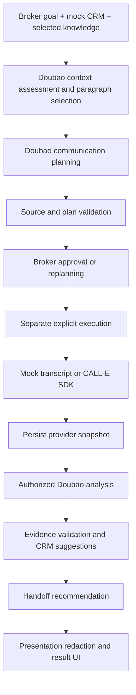

# Architecture

## Execution flow

## Responsibilities

| Module | Responsibility |
| --- | --- |
| `demo/streamlit_app.py` | Preparation, planning review, explicit execution, same-call polling and result views. |
| `demo/privacy.py` | Presentation-only redaction of textual outputs and nested JSON; never rewrites execution/evidence inputs. |
| `demo/results.py` | Read-only business projection and filtering of empty suggestions; no inference or persistence. |
| `services/workflow.py` | Durable task state, revision checks, approval, dispatch identity, consent, result processing and preview enforcement. |
| `agent/context.py` | Context source map, selection checks and reproducible offline assessment. |
| `agent/planning.py` | Plan validation and compilation of the reviewed task and flat provider result schema. |
| `agent/extraction.py` | Transcript-grounded changes, attribution, uncertainty and intent/handoff rules. |
| `integrations/llm.py` | Doubao planning/analysis and bounded structured-output validation. |
| `integrations/calle.py` | Fake provider and optional official CALL-E SDK adapter at the approved credential origin. |
| `integrations/crm.py` | Access to synthetic CRM context and data boundary. |
| `storage.py` | SQLite execution records, history and test-only transactional writeback prototype. |
| `knowledge.py` | Selected Markdown loading, source/date metadata and frozen paragraph snapshots. |

## Data and temporal boundaries

The packaged JSON files contain fictional customers, properties, completed viewings and independent replay cases. Initial viewings contain no feedback. Pre-call context cannot contain preferences learned only in the eventual transcript. Selected knowledge and facts are frozen for review; replanning creates a revised task that must be approved again.

SQLite stores execution state, plans, immutable call snapshots, analysis and proposals. Customer and viewing reads in the default/Web flow use the initial mock snapshot. A successful analysis means suggestions are ready, not that a CRM was changed. The separate writeback prototype is enabled only by explicit internal tests.

CALL-E receives a compiled task containing identity, objectives, concise factual context, communication directions, boundaries and expected outcomes. Internal confidence labels, source-selection reasoning and entire unselected knowledge files stay local. A deterministic schema compiler supplies flat string result fields for the selected viewings, within the provider property limit. The examples illustrate this boundary without placing a call.

The analysis schema is distinct from the provider schema. Doubao turns the provider snapshot and approved context into typed proposed changes. Evidence must match the referenced user transcript turn, and property/customer attribution must belong to the approved context. Missing or ambiguous evidence remains pending rather than authorizing a guessed update.

## Progress, recovery and privacy

Streamlit invokes synchronous workflow steps. Its fragment polls an existing live Call every three seconds while that page is open; no independent background worker is claimed. The app persists state before dispatch. Unknown acceptance retains the original request/idempotency identity and requires explicit recovery; it is never treated as permission to submit a new call. Analysis failure retries analysis, not dialing. A pending business result can outlast call execution; final unavailability terminates monitoring.

UI text is redacted at the presentation boundary, including errors and raw structured data. Original private dispatch parameters, evidence and local snapshots remain intact for correctness and authorized processing. The facade also guards column-bound output methods and recursive JSON values/keys. Redaction is a conservative numeric-phone filter, not a guarantee of anonymization, and does not modify source audio.

The app is a trusted-local-machine demo. No production identity service, real CRM, scheduler, event bus or telephony stack is implemented. CALL-E owns telephone execution and voice interaction. The broker owns approval and commercial commitments. Real transcript analysis requires explicit deployment/task authorization; new configuration templates default to no authorization.
