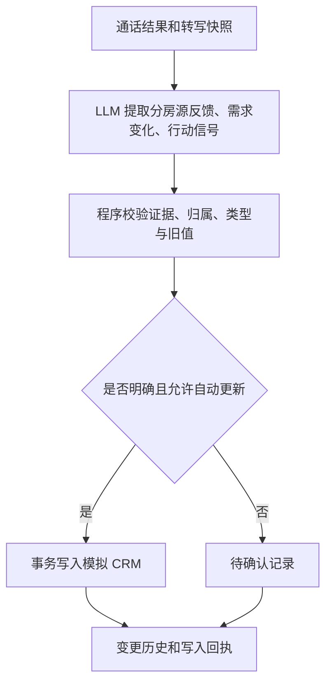
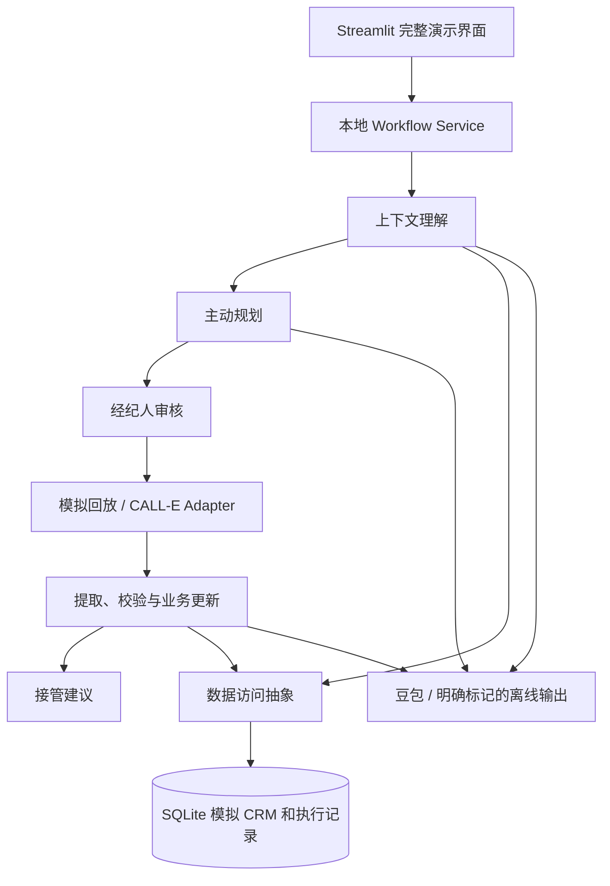

# Phase 0：四种 Agent 能力与最小技术设计

**V3.0｜2026-11-02｜设计讨论稿，历史架构稿；已实现范围以 purpose 对齐记录为准**

本文取代此前以独立 FastAPI 服务为中心的设计。当前用户明确要求先用中文规划；不以英文社区规范作为本轮完成条件。公开提交时再提供英文材料。

## 一、设计目标和交付物

定位：具备业务上下文理解、主动通话规划、结构化业务执行和人机协作能力的房产客户跟进 Agent，基于 CALL-E 完成电话交互。

第一版应交付四项可查看、可质疑、可验证的业务产物：

1. **客户理解卡**：相关事实、历史变化信号、矛盾、缺口、被排除的信息和依据。
2. **主动通话计划**：重点问题、原因、优先级、不必重复项、核实项和回答分支。
3. **业务变更记录**：房源反馈、需求旧值/新值、证据、写入结果和待确认事项。
4. **人机协作建议**：计划审核记录、机会信号、接管理由和建议下一步。

技术选型服务于这些产物；不把 API 返回成功、框架数量或未来可接入性作为智能性的证明。

## 二、Context-aware：怎样从资料形成判断

### 输入来源

- 客户画像：当前明确预算、区域、户型、购房时间、偏好与联系限制。
- 历史沟通：客户原话、时间、来源、已确认事项和待确认承诺。
- 带看记录：看过哪套、何时看、此前反馈、经纪人观察。
- 房源信息：价格、面积、客厅、地铁距离、挂牌状态、更新时间。
- 本次目标与可用候选：经纪人目标，以及 CRM 已提供的候选和匹配理由。

### 处理步骤

1. 程序按客户和房源 ID 关联资料，统一日期、币种、计量单位及来源标识。
2. LLM 综合资料，形成相关事实、变化信号、冲突、缺口和优先级判断。
3. 每个判断引用实际存在的 source_id；区分用户明确表达、经纪人观察和模型假设。
4. 程序校验引用、字段、房源归属及结构。无来源结论降为待核实或退回，不进入确认事实。
5. 按本次目标筛选通话知识包，保留「采用/排除及原因」，而不是把全量历史塞进 Task。

时间新不自动代表信息更可靠；资料过期也不是固定几天一刀切。第一版可配置房源状态有效期，并在 fixtures 中冻结评估日期，不使用今天的日期倒推历史语义。

### 示例：从信息到理解

| 原始信息 | 合理判断 | 不能推出的结论 |
| --- | --- | --- |
| 历史上重视地铁；最近看过更远但更大的 B | 需要了解交通与空间的取舍 | 已经接受远离地铁 |
| 经纪人记录 A 客厅偏小 | 可以优先问 A 的空间体验，是否影响决策 | 客户已确认客厅是最高优先级 |
| 当前预算上限 500 万，B 报价 530 万 | 有预算与房源价格之间的差距，视上下文决定是否澄清 | 客户愿意加到 530 万 |
| B 报价记录较旧、最新状态未知 | 推荐前需核实，不承诺仍可售或可议价 | 已降价或已售出 |

理解卡不应展示模型隐藏推理过程，只展示简短业务结论、引用和待验证问题。

## 三、Proactive Planning：怎样决定本次怎么聊

输入为经纪人目标、经过校验的理解卡和可用知识包。LLM 输出：

| 字段 | 作用 |
| --- | --- |
| objective | 本次希望澄清的业务问题 |
| question / priority | 问什么，以及先后顺序 |
| reason / evidence_refs | 为什么问，来自哪些事实或冲突 |
| expected_information | 希望补齐哪个需求、反馈或决策信号 |
| skip_questions | 哪些已经知道，不应从头再问 |
| verification_items | 哪些信息要核实，未知时怎样回应 |
| response_branches | 不同回答下的追问或结束策略 |
| constraints | 不能编造的事实、不能擅自作出的承诺 |

对于「跟进张女士上次看房情况」，计划应优先区分 A/B 的体验，再了解客厅、地铁和价格之间的权衡。预算已确认时，不重复完整问卷；只有相关取舍或矛盾出现时才追问弹性。

分支例如：客户仍坚持 500 万，则不继续推销超预算 B；客户只表示也许加一点，记录未确认弹性；客户明确想复看 B，则了解诉求并交给经纪人，不自行谈价。

经纪人可以修改问题、顺序、事实与禁区。确认的版本包含目标、知识包、问题、号码/语言和约束；重要修改后需要重新确认。计划生成不等于授权拨号。

审核后才编译最终 CALL-E task 和 result_schema。前端展现业务计划，技术 Schema 默认折叠，避免把实现参数变成产品操作负担。

## 四、Business Action：怎样让电话改变业务状态

### 更新规则

- 客户未提及的字段保持旧值。
- A/B 反馈分别关联正确 viewing_id/property_id；含糊的「那套」不得猜测归属。
- 明确、低风险变化先进入更新建议，批次经纪人确认后写入；预算上限等高影响变化，即使有具体原话也先供经纪人确认。
- 「可能加一点」保存潜在变化与待确认问题，不伪造数值。
- 没有证据、资料冲突或版本已过期，暂停相关字段写入；其他可靠字段可以按批次记录结果。
- 写入失败可以重试；相同结果版本和字段操作不能重复追加。
- 联系限制优先于营销动作；明确拒绝联系时保存限制，并在后续拨号前重新检查。

### 证据和可追溯性

每条重要变更保留：客户/房源/带看 ID、字段、旧值、新值、操作类型、状态、关联通话、转写快照版本、发言位置、原话、可用时间。

程序检查原话是否出现在对应用户发言里，但原话匹配只证明来源，不能证明含义判断正确。模糊表达、归属不清和明显冲突进入待确认。

演示必须读取数据库中的已保存状态，不能只在页面展示一个模型建议对象。

## 五、Human-AI Collaboration：怎样主动发现机会

电话前由经纪人审核目的、重点、事实、约束与联系权限。电话后由 LLM 提取机会信号，程序按可解释规则生成建议。

- 「挺喜欢」是一般积极反馈，不等于马上成交。
- 明确关联某套房、提出近期复看/具体推进意愿，是值得优先跟进的信号。
- 希望谈价属于经纪人处理范围，不赋予 AI 谈判或承诺价格的权力。
- 存在条件、反向证据或指代不清，必须与积极信号一起展示。
- 线索高优先级是建议，不是对购买概率的准确预测。

接管卡至少显示：客户、相关房源、明确诉求、关键原话、为什么值得跟进、仍待确认什么、建议经纪人做什么。保存模拟 CRM 的意向/需人工跟进字段，并生成去重提醒；不能声称已经向真实 CRM 或真人发送消息。

## 六、最小实现结构

- Streamlit 可以直接调用本地工作流服务，不要求 HTTP 中间层。
- 模块独立于控件，便于测试；页面不散布 SQL 或电话请求。
- Python + SQLite + Pydantic + pytest 足以先跑通；FastAPI 暂不纳入必需实现。
- 保留 CRM 数据访问与 CALL-E 调用抽象，不实现通用 CRM 平台、MCP Server 或多 Agent 框架。
- 为演示选择可控的逐步执行和恢复方式，不预先承诺关闭界面后仍持续执行所有本地分析。已提交的远程电话仍可能继续，必须保留查询/恢复引用。

### 同步、异步与恢复

本次理解、规划、结果分析按依赖顺序执行；LLM 请求可能等待网络。先显示阶段和进度，不持有跨网络请求的数据库事务。

CALL-E 接受请求后远程异步执行，应用保存原请求、幂等键和资源 ID，定期读取状态；暂不开发结果 Webhook。关闭页面后可重新载入同一任务继续查询，不重新发起电话。

提取失败只重做提取，写入失败只重试同一批次。提交结果未知时保留原身份恢复，不换 key 重拨。没有采用后台常驻执行器，不应宣称它已存在；后续确有需要再补。

## 七、最小数据与业务状态

| 数据 | 主要内容 |
| --- | --- |
| customers | 当前需求、联系限制、意向、是否需要人工跟进和数据版本 |
| communication_history | 历史沟通原话、来源、时间与确认状态 |
| properties / viewings | CRM 提供的房源事实、状态、带看关联和反馈 |
| context_assessments | 事实、假设、冲突、缺口、相关性和来源引用 |
| call_plans | 目标、问题优先级/原因、不重复项、核实项、回答分支和审核版本 |
| call_executions / call_results | 模式、原请求/幂等键、状态、结果、转写快照和分析版本 |
| preference_changes / writeback_logs | 旧值/新值、证据、待确认/已应用/失败、幂等身份 |
| notifications / followup_suggestions | 接管理由、证据、建议行动和处理状态 |
| crm_events | 后续阶段的模拟 CRM 事件及处理状态 |

阶段可简化为：待理解 → 待审核 → 已确认 → 电话执行/回放 → 结果处理 → 已回填/待确认/失败。电话执行、结果提取和写入分别有状态，不因电话结束就宣告整个任务成功。

一条带看记录属于一个客户和一套房；一次通话关联一个确认版本；一次通话可以产生多套房反馈、多项变化和提醒。

## 八、CALL-E 能力边界

沿用此前官方资料核对：

- 当前独立电话通过 `/v2/calls` 创建，任务正文携带本次知识与约束；API Key 与宿主 MCP OAuth 分开。
- 结果 Schema 是至多 32 个标量属性的闭合对象，不能直接使用数组或嵌套记录。本地模型可以更丰富，边界处编译为扁平字段。
- 用 Call 的资源 id 查询，不用 Billing 关联 call_id 替代。
- 执行完成与业务结果就绪分开，按 result_status 决定是否继续等待。
- 转写可能为空或不完整；事件观察不证明用户已听到某段。
- 取消仅限供应商提交前，不承诺主动挂断；通话中动态检索、实时转人工未作为已验证能力。

这部分依据之前的文档核对，不是本轮重新实测。参考：[Calls](https://docs.heycall-e.com/calls)、[API Reference](https://docs.heycall-e.com/api-reference/calls)、[SDK](https://docs.heycall-e.com/sdks)。真实账号权限、额度、语言、通话体验及本项目 SDK 路径仍需单独测试。

## 九、页面应展示什么

1. **客户与理解**：输入简短目标，展示资料来源、关键判断、冲突缺口、纳入/排除的背景。
2. **规划与审核**：展示重点问题、理由、不重复项、分支和约束，经纪人编辑确认后执行。
3. **结果与业务动作**：转写、分房源反馈、新旧值/证据/实际写入、待确认及接管卡。
4. **对照视图**：同一案例的固定 Task 与 Agent 方案，显示问题差异和评分依据；未实测项保持空缺。

技术 ID、原始 JSON 和 Schema 可以折叠，不成为主叙事。

## 十、当前状态与待确认决策

已完成：独立环境和工程骨架、文档规划。未完成：客户理解、主动规划、运行页面、模拟电话、业务回填、接管及评估测试。本轮只更新文档，没有新增业务代码、读取凭证、拨号或修改 CALL-E 核心。

建议确认的基线：Streamlit + 本地工作流，不强制 FastAPI；四种能力优先；有来源的理解与规划可视化；保守回填和人工审核；离线对照先于真实测试；持续跟进事件后续展示。

详细任务见 [Phase 1](phase-1-plan.md)，评估设计见 [对照方案](evaluation-plan.md)。

## 实施状态补记（2026-11-02）

用户已确认设计并授权开发。上述 Phase 0 内容保留为设计依据，具体实现与限制以 [Phase 1 验证](phase-1-verification.md) 为准。当前实现采用本地显式步骤，没有常驻后台服务。

## 当前交互依据

当前按 [purpose.md](purpose.md) 实施，见 [对齐记录](purpose-alignment.md)：四页导航、浦东统一案例、结果先预览后确认写入。原稿中与该流程不同的展示安排已被替代。
